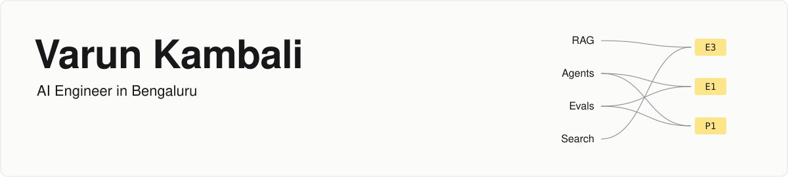

<picture>
  <source media="(prefers-color-scheme: dark)" srcset="assets/header-dark.svg">
  
</picture>

  
  
  

## Hi, I'm Varun

I like getting to the root of things. Give me a system that is misbehaving and I'll go looking for the bottleneck that is actually causing it, and for the pattern that isn't obvious at first glance but matters to the people who use it.

I'm an AI Engineer in Bengaluru with 3+ years shipping production LLM systems on Google Cloud: retrieval, agents and evaluation for enterprise clients in SaaS, legal and travel. I'm currently a Senior AI Engineer at Searce. There's more about how I work, and the evidence behind every skill below, on my [portfolio](https://varun-kambali.github.io).

## Arsenal

| Area | Tools and patterns |
|---|---|
| **LLMs & agents** |       |
| **Patterns** |      |
| **Retrieval & data** |      -3F3F46?style=for-the-badge) |
| **Evaluation** |    |
| **Google Cloud** |      |
| **Backend** |       |

## Shipped in production

**Hiring for something specific?** See only the matching work on my evidence map: [RAG](https://varun-kambali.github.io/?lens=rag#evidence) · [Agents](https://varun-kambali.github.io/?lens=agents#evidence) · [Evals](https://varun-kambali.github.io/?lens=evals#evidence) · [Search](https://varun-kambali.github.io/?lens=search#evidence) · [Data & cloud](https://varun-kambali.github.io/?lens=data#evidence)

Client work is under NDA, so it's described at resume level. Each ID opens that line on my [evidence map](https://varun-kambali.github.io), with the skills it used.

| | Work | Result |
|---|---|---|
| [**E1**](https://varun-kambali.github.io/?line=E1#evidence) | **Agentic NL2SQL** for executive reporting: a self-correcting loop validates and repairs SQL before execution | **92%** execution accuracy on **500+** evaluation questions, across 20 markets |
| [**E3**](https://varun-kambali.github.io/?line=E3#evidence) | **Multi-tenant RAG platform** (FastAPI, PostgreSQL, Azure AD SSO): routing → datastore selection → grounded synthesis → citation verification | Tenant onboarding cut from 1–2 days to **under 5 minutes** |
| [**E5**](https://varun-kambali.github.io/?line=E5#evidence) | **Hybrid search** for a screen-capture SaaS: PGVector with keyword-weighted ranking (HNSW + weighted RRF). Led 3 engineers | **10M+** screenshots, audio, video and files |
| [**E6**](https://varun-kambali.github.io/?line=E6#evidence) | **Multimodal enrichment**, event-driven on Gemini (Pub/Sub, Cloud Functions, BigQuery): OCR, diarized transcription, metadata | **2M+** captures/month |
| [**E7**](https://varun-kambali.github.io/?line=E7#evidence) | **LLM evaluation tool** (async Python, LiteLLM, Streamlit) with a Gemini Flash judge on 4 criteria, plus latency and token cost | **5+** models compared in parallel; the AI team's standard for model selection |

## Building in public

My client code can't be shared, so these open-source projects are the code you can read. Each ships with a committed eval suite, and its headline number appears here by itself.

<!-- sync:projects:start -->
| | Project | What it is | Status | Headline result |
|---|---|---|---|---|
| P1 | **[Nutrition MCP server](https://github.com/Varun-Kambali/nutrition-mcp)** · [case study](https://github.com/Varun-Kambali/nutrition-mcp/blob/main/docs/case-study.md) | MCP server that returns sourced nutrition, glycemic load and micronutrient data for Indian dishes, in grams or household measures. | Shipped v1.0.0 | [Calorie error against the dataset totals, MAPE (%): 16.0 → 0.0](https://github.com/Varun-Kambali/nutrition-mcp/blob/main/evals/results/summary.md) |
| P2 | **[Meal-planner multi-agent](https://github.com/Varun-Kambali/meal-planner-agents)** · [case study](https://github.com/Varun-Kambali/meal-planner-agents/blob/main/docs/case-study.md) | LangGraph agents write recipes for the meal plan you already follow, check every number in code through nutrition-mcp over MCP, and track meals against it. | In progress | [Recipes passing every recipe check (share): 8.3% (46 of 553) → 86.6% (479 of 553)](https://github.com/Varun-Kambali/meal-planner-agents/blob/main/evals/results/summary.md) |
| P3 | **Household docs vault** | Private document AI that runs locally: field extraction, expiry reminders and cited answers, on a LoRA-fine-tuned open-weight model. | Planned | Not run yet |
<!-- sync:projects:end -->

Synced daily from each project's repo. Last change: <!-- sync:stamp:start -->29 Oct 2026<!-- sync:stamp:end -->

## Certified

