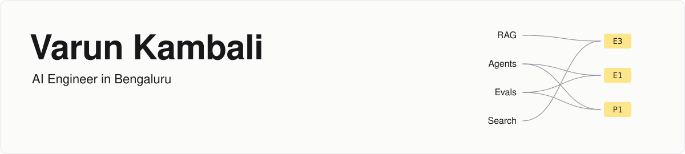

<picture>
  <source media="(prefers-color-scheme: dark)" srcset="assets/header-dark.svg">
  
</picture>

  
  
  

## Hi, I'm Varun

I like getting to the root of things. Give me a system that is misbehaving and I'll go looking for the bottleneck that is actually causing it, and for the pattern that isn't obvious at first glance but matters to the people who use it.

I'm a Senior AI Engineer at Searce in Bengaluru. For 3+ years I've built LLM systems that run in production on Google Cloud (retrieval, agents, search and evaluation) for enterprise clients in SaaS, legal and travel. More about me on my [portfolio](https://varun-kambali.github.io).

## What I've shipped at work

**Agents and RAG that check their own work**

- **92% execution accuracy on 500+ evaluation questions.** I built an NL2SQL and vector-search reporting agent for executive leadership in 20 markets. A self-correcting loop validates and repairs the SQL before it runs.
- **Tenant onboarding cut from 1–2 days to under 5 minutes.** I architected a multi-tenant RAG platform (FastAPI, PostgreSQL, Azure AD SSO) with a 4-stage agent pipeline: routing, datastore selection, grounded synthesis and citation verification.

**Search and data at scale**

- **Search over 10M+ screenshots, audio, video and files.** I led 3 engineers building search for a screen-capture SaaS, moving it to PostgreSQL/PGVector with keyword-weighted hybrid ranking (HNSW + weighted RRF).
- **2M+ captures a month made searchable.** I built the event-driven Gemini pipeline behind that search (Pub/Sub, Cloud Functions, BigQuery): OCR, speaker-labelled transcription and metadata extraction.
- **New-market onboarding from multi-day deployments to under a minute.** I designed a config-driven, partitioned BigQuery ingestion engine for the same 20 markets, so adding one is a config change.

**Evaluation and client delivery**

- **The AI team's standard for choosing models.** My evaluation tool runs 5+ models in parallel on the same prompts, scores them with a Gemini Flash judge on 4 criteria, and adds latency and token cost (async Python, LiteLLM, Streamlit).
- **An MVP that became a production engagement.** I led discovery, design and delivery of a Gemini Enterprise MVP with a custom BigQuery natural-language analytics agent over 10 datasets (100+ tables).

## Open-source projects

I build these in my own time, and each one ships with its own evals.

<!-- sync:projects:start -->
### [Nutrition MCP server](https://github.com/Varun-Kambali/nutrition-mcp) · shipped v1.0.0

When I asked AI assistants how much protein is in 2 rotis and a katori of rajma, I got a confident number with no source and no portion. So I built an open-source MCP server that any agent can call for sourced nutrition on 41 Indian dishes and 66 ingredients, in grams or household measures. Dish values are computed in code from USDA and CoFID ingredient data and recipes I wrote, so the model never does the arithmetic.

From memory, Gemini was off by 16.0% on calories. With the server's tools it used the computed totals on 26 of 26 questions. A CI gate checks 18 dishes against independent CoFID and USDA records, at 18.7% average calorie error.

[Why I built it](https://github.com/Varun-Kambali/nutrition-mcp/blob/main/docs/case-study.md) · [Eval results](https://github.com/Varun-Kambali/nutrition-mcp/blob/main/evals/results/summary.md)

### [Meal-planner multi-agent](https://github.com/Varun-Kambali/meal-planner-agents) · shipped v1.0.0

I follow a meal plan I wrote myself. Writing the rules was quick; finding recipes that hit each meal's numbers, fit my kitchen and don't repeat was the slow part. Here you enter your plan's rules once, LangGraph agents write a week of recipes, my nutrition MCP server supplies every number, and plain Python checks each recipe and day, sending failures back for repair. Then it tracks what you actually eat against the plan.

479 of 553 recipes pass every check, against 46 of 553 when a single model call writes the whole week. Evals gate CI, and the Langfuse traces mask every string except ids.

[Live demo](https://varun-kambali.github.io/meal-planner-agents/) · [Why I built it](https://github.com/Varun-Kambali/meal-planner-agents/blob/main/docs/case-study.md) · [Eval results](https://github.com/Varun-Kambali/meal-planner-agents/blob/main/evals/results/summary.md)

Up next: **Household docs vault**, private document AI that runs locally: field extraction, expiry reminders and cited answers, on a LoRA-fine-tuned open-weight model.
<!-- sync:projects:end -->

Updated <!-- sync:stamp:start -->10 Nov 2026<!-- sync:stamp:end -->

## Arsenal

| Area | Tools and patterns |
|---|---|
| **LLMs & agents** |       |
| **Patterns** |      |
| **Retrieval & data** |      -3F3F46?style=for-the-badge) |
| **Evaluation** |    |
| **Google Cloud** |      |
| **Backend** |       |

## Certified

